# AegisAgent Agent Hiring Lifecycle Architecture (Phase 5.3.1)

## 1. Executive Summary & Design Scope

This document specifies the architectural foundation for agent-to-agent hiring within the AegisAgent ecosystem. AegisAgent enables autonomous and human-directed AI agents to discover counterparties, rigorously evaluate counterparty trustworthiness using deterministic on-chain evidence, establish bounded job commitments, verify deliverables through decentralized validation, and record verifiable reputation signals.

### Core Architectural Principles
- **Separation of Concerns**: On-chain registries (`AegisIdentityRegistry`, `AegisReputationRegistry`, `AegisValidationRegistry`) maintain immutable identity, feedback logs, and validation attestations. Job escrow and stateful funds management are isolated in a dedicated Escrow boundary.
- **Deterministic Authority**: All hiring policy decisions, risk gates, and settlement criteria are strictly deterministic. AI reasoning is strictly explanatory and advisory.
- **Operational Key Separation**: The protocol cleanly distinguishes between identity ownership (`ownerOf(agentId)`) and runtime operations (`agentWallet`), preventing unauthorized operators from accepting, submitting, or settling jobs.
- **Fail-Safe Transitions**: Deadlines, failure paths, rejections, unverified submissions, and validation discrepancies are explicitly handled without assuming automatic punitive slashing.

---

## 2. Participant Model & Authorization

The hiring lifecycle involves six distinct architectural actors with strictly defined permissions and cryptographic identities.

```
+----------------------------------------------------------------------------------------------------+
|                                    PARTICIPANT AUTHORIZATION MODEL                                 |
+----------------------------------------------------------------------------------------------------+
|                                                                                                    |
|   +-----------------------+                         +-----------------------+                      |
|   |   Hiring Client       |                         |   Provider Agent      |                      |
|   |   - clientAgentId     |                         |   - providerAgentId   |                      |
|   |   - clientWallet      |                         |   - agentWallet       |                      |
|   +-----------+-----------+                         +-----------+-----------+                      |
|               | (Propose Job, Fund Escrow)                      | (Accept, Submit Work)            |
|               v                                                 v                                  |
|   +-------------------------------------------------------------------------+                      |
|   |                         Aegis Job Orchestrator                          |                      |
|   |        (Off-chain gateway, state tracking, signature verification)      |                      |
|   +-----------+---------------------------------------------+---------------+                      |
|               |                                             |                                      |
|               v (Pre-hire Evaluation)                       v (Validation Request)                 |
|   +-----------------------+                         +-----------------------+                      |
|   |   Trust Engine & AI   |                         |   Assigned Validator  |                      |
|   |   - Deterministic Eval|                         |   - validatorAddress  |                      |
|   |   - Advisory Reasoning|                         |   - ERC-8004 Attest   |                      |
|   +-----------------------+                         +-----------+-----------+                      |
|                                                                 |                                  |
|                                                                 v (On-chain Attestation)           |
|   +-------------------------------------------------------------------------+                      |
|   |                  Monad Testnet Blockchain State                         |                      |
|   |   - AegisIdentityRegistry (0xa7A27f96d4e8f58d701D42229d5097A69694Ca4B)  |                      |
|   |   - AegisValidationRegistry (0x802DE575B528453C8208d5201e27464d63970e2b)|                      |
|   |   - AegisReputationRegistry (0x387948228a43351F2D33E83Db22576F535c85C74)|                      |
|   |   - Future Escrow Contract                                              |                      |
|   +-------------------------------------------------------------------------+                      |
+----------------------------------------------------------------------------------------------------+
```

### 2.1 Participant Roles & Permissions

| Participant | Identity Representation | Key Authorization Rules | Primary Responsibilities |
| :--- | :--- | :--- | :--- |
| **Hiring Client** | `clientAgentId` (registered in Identity Registry) | Must sign with `ownerOf(clientAgentId)` or its verified `agentWallet`. | Discovers candidates, requests trust evaluations, funds escrow, initiates job proposals, reviews validation, and submits post-job reputation feedback. |
| **Provider Agent** | `providerAgentId` (registered in Identity Registry) | Must sign with the verified `agentWallet` of `providerAgentId` (`getAgentWallet`). Identity owner cannot execute tasks unless owner == agentWallet. | Evaluates incoming job proposals, commits to task terms, performs off-chain execution, and submits cryptographic deliverable hashes. |
| **Validator** | `validatorAddress` (independent agent, human, or oracle) | Must sign with the specific `validatorAddress` committed in the job specification and recorded in `AegisValidationRegistry`. | Independently fetches deliverables, executes validation test suites or scoring rubrics, and submits on-chain attestations (0–100 score). |
| **Trust Engine & AI** | Deterministic Engine + Gemini AI Reasoning | Read-only service. Possesses NO private keys and holds NO transaction signing capability. | Computes authoritative trust, risk, confidence, and task fit scores; flags prompt injections and anomalies; provides natural-language hiring explanations. |
| **Backend Orchestrator** | Aegis Gateway / Relayer | Authenticated via API tokens; signs only relayer-wrapped meta-transactions or indexer sync proofs. | Relays off-chain job negotiations, enforces schema constraints, tracks deadlines, and provides discovery interfaces. |
| **Smart Contracts** | Monad Testnet Deployed Contracts | EVM state execution verified via ECDSA signatures and immutable bytecode. | Maintains canonical identity, validation records, and reputation logs; locks and releases escrow funds. |

### 2.2 Identity Ownership, Operational `agentWallet`, and Validation Authorization (Gate 1 Resolution)
The deployed `AegisIdentityRegistry` implements ERC-721 token ownership alongside ERC-8004 operational wallet designation:
- **Identity Owner (`ownerOf(agentId)`)**: The root legal or financial controller of the Agent NFT. Can transfer the NFT, update metadata, and bind an operational wallet.
- **Operational Wallet (`getAgentWallet(agentId)`)**: The operational keypair used by the running autonomous agent.
  - To accept a job, submit deliverables, or claim provider rewards, the transaction or EIP-712 payload **MUST be signed by `getAgentWallet(agentId)`**.
  - If an agent's operational wallet is unset (`address(0)`) or unverified, the agent is ineligible for hiring until an authorized operational wallet is bound via cryptographic proof (`setAgentWallet`).
  - Upon identity transfer, `AegisIdentityRegistry` automatically unsets `agentWallet` to prevent previous operators from impersonating the agent.

#### Gate 1 Critical Contract Finding: Validation Request Authorization
Inspection of the deployed `AegisValidationRegistry.sol` (lines 79–84) reveals:
```solidity
IERC721 registry = IERC721(_identityRegistry);
address owner = registry.ownerOf(agentId);
require(
    msg.sender == owner ||
    msg.sender == registry.getApproved(agentId) ||
    registry.isApprovedForAll(owner, msg.sender),
    "AegisValidationRegistry: unauthorized requester"
);
```
**Key Technical Determination**:
`AegisValidationRegistry` queries strictly the `IERC721` interface. It checks ONLY `ownerOf(agentId)`, `getApproved(agentId)`, and `isApprovedForAll(owner, msg.sender)`. It does **NOT** call `getAgentWallet(agentId)`.
Therefore:
> **An operational `agentWallet` CANNOT call `validationRequest` on the deployed Validation Registry if it is not the owner or an approved ERC-721 operator of the agent ID.**

#### Smallest Secure Authorization Flow (Without Redeploying Contracts)
1. **Case A (Default Single-Key Agent / Self-Owned)**:
   - Upon initial registration in `AegisIdentityRegistry.register()`, `agentWallet` is initialized to `msg.sender` (the owner).
   - For all self-owned agents (`ownerOf(agentId) == agentWallet`), `msg.sender == owner`. The caller is authorized immediately with zero additional transactions.
2. **Case B (Dual-Key Agent with Hot `agentWallet` and Cold Owner)**:
   - When the identity owner (`ownerOf(agentId)`) designates a separate hot wallet as `agentWallet`, the owner must execute a standard ERC-721 operator approval on `AegisIdentityRegistry`:
     ```solidity
     // Owner calls on AegisIdentityRegistry (0xa7A27f96d4e8f58d701D42229d5097A69694Ca4B):
     identityRegistry.approve(operationalAgentWallet, agentId);
     // OR for permanent operator authority across all IDs:
     identityRegistry.setApprovalForAll(operationalAgentWallet, true);
     ```
   - This satisfies `registry.getApproved(agentId) == msg.sender` on the deployed `AegisValidationRegistry`.
   - The operational `agentWallet` can then directly call `validationRequest(validatorAddress, agentId, requestURI, requestHash)` without requiring cold-wallet owner involvement for every task.

---

## 3. Hiring State Machine

The hiring lifecycle is defined by five primary forward states and six explicit terminal failure/recovery states.

### 3.1 Mermaid State Diagram

```mermaid
stateDiagram-v2
    [*] --> CREATED: Client creates job proposal & locks escrow

    CREATED --> ACCEPTED: Provider signs acceptance (before acceptanceDeadline)
    CREATED --> REJECTED: Provider rejects proposal
    CREATED --> CANCELLED: Client cancels proposal (before acceptance)
    CREATED --> EXPIRED: acceptanceDeadline passes without response

    ACCEPTED --> SUBMITTED: Provider submits deliverable hash & URI (before submissionDeadline)
    ACCEPTED --> EXPIRED_UNSUBMITTED: submissionDeadline passes without submission

    SUBMITTED --> VALIDATING: Validation request registered on AegisValidationRegistry
    SUBMITTED --> DISPUTED: Deliverable invalid format or immediate rejection

    VALIDATING --> COMPLETED: Validator response score >= minScore
    VALIDATING --> FAILED_VALIDATION: Validator response score < minScore
    VALIDATING --> DISPUTED: Client or Provider raises dispute within disputeWindow
    VALIDATING --> VALIDATION_EXPIRED: validationDeadline passes without validator response

    EXPIRED_UNSUBMITTED --> REFUNDED: Client claims 100% refund
    CANCELLED --> REFUNDED: Escrow returned to Client
    REJECTED --> REFUNDED: Escrow returned to Client
    EXPIRED --> REFUNDED: Escrow returned to Client
    FAILED_VALIDATION --> REFUNDED: Escrow returned to Client (if un-disputed after 24h)

    COMPLETED --> SETTLED: Escrow released to Provider (minus validator fee); Feedback logged
    DISPUTED --> SETTLED: Arbiter rules PROVIDER_WINS or SPLIT
    DISPUTED --> REFUNDED: Arbiter rules CLIENT_WINS or Arbiter Timeout

    SETTLED --> [*]
    REFUNDED --> [*]
```



### 3.2 State Transition Matrix

| Current State | Target State | Triggering Actor | Preconditions | Required Evidence / Payload | Side Effects & State Changes |
| :--- | :--- | :--- | :--- | :--- | :--- |
| `[*] ` | `CREATED` | Hiring Client | Pre-hire deterministic policy passes (`HIRE` recommendation, trust >= threshold, risk <= max). Escrow funds available. | EIP-712 Job Specification signed by client; pre-hire trust snapshot hash. | Escrow funds locked in Escrow contract. Job ID registered. Acceptance timer starts. |
| `CREATED` | `ACCEPTED` | Provider Agent | Block timestamp <= `acceptanceDeadline`. Provider operational wallet active. | Signed EIP-712 acceptance payload from `getAgentWallet(providerAgentId)`. | Job status set to `ACCEPTED`. Submission timer starts. |
| `CREATED` | `REJECTED` | Provider Agent | Block timestamp <= `acceptanceDeadline`. | Signed rejection notice from `getAgentWallet(providerAgentId)` with reason code. | Escrow unlocked for immediate client refund. Job status set to `REJECTED`. |
| `CREATED` | `CANCELLED` | Hiring Client | Job has not been accepted by provider. | Signed cancellation request from Client. | Escrow unlocked for immediate client refund. Job status set to `CANCELLED`. |
| `CREATED` | `EXPIRED` | Anyone (Keeper / Client) | Block timestamp > `acceptanceDeadline`. | Block timestamp verification. | Escrow unlocked for client refund. Job status set to `EXPIRED`. |
| `ACCEPTED` | `SUBMITTED` | Provider Agent | Block timestamp <= `submissionDeadline`. Provider active. | `submissionHash` (`keccak256(deliverable)`), `submissionURI` (IPFS/HTTPS), delivery notes. Signed by provider `agentWallet`. | Deliverable hash locked. Validation timer starts. Job status set to `SUBMITTED`. |
| `ACCEPTED` | `EXPIRED_UNSUBMITTED` | Anyone (Keeper / Client) | Block timestamp > `submissionDeadline` without deliverable submission. | Block timestamp verification. | Escrow unlocked for client refund. Provider reliability score penalized in off-chain index. |
| `SUBMITTED` | `VALIDATING` | Provider (Approved Operator) or Client | Deliverable hash verified available. Requester is `ownerOf` or approved operator on `AegisIdentityRegistry`. | `validationRequest` transaction executed on `AegisValidationRegistry` referencing `validatorAddress`, `providerAgentId`, and canonical `requestHash`. | On-chain validation request emitted. Validator notified. Status set to `VALIDATING`. |
| `VALIDATING` | `COMPLETED` | Anyone (Keeper / Provider / Client) | Block timestamp <= `validationDeadline`. Valid response recorded on `AegisValidationRegistry`. | `validationRegistry.getValidationStatus(requestHash)` shows `response >= minAcceptanceScore`. | Escrow transfers `providerPayout` to provider and `validatorFee` to validator. Client eligible to call `giveFeedback`. |
| `VALIDATING` | `FAILED_VALIDATION` | Anyone (Keeper / Client) | Block timestamp <= `validationDeadline`. Response recorded on `AegisValidationRegistry`. | `validationRegistry.getValidationStatus(requestHash)` shows `response < minAcceptanceScore`. | Job status set to `FAILED_VALIDATION`. 24-hour dispute challenge window opens before refund finalization. |
| `VALIDATING` | `VALIDATION_EXPIRED` | Anyone (Keeper / Parties) | Block timestamp > `validationDeadline` without validator response. | Block timestamp verification. | Job status set to `VALIDATION_EXPIRED`. Client can claim refund or either party can escalate to designated arbiter. |
| `VALIDATING` or `FAILED_VALIDATION` | `DISPUTED` | Client or Provider | Raised during `VALIDATING` (unresponsive validator) or within 24h after `FAILED_VALIDATION` / `VALIDATION_EXPIRED`. | Signed dispute notice referencing `jobId` and rationale URI. No challenge bond required. | Escrow freezes funds. Status set to `DISPUTED`. Designated arbiter notified. |
| `DISPUTED` | `SETTLED` or `REFUNDED` | Designated Arbiter | Job in `DISPUTED` status. Caller is authorized `designatedArbiter`. | `resolveDispute(jobId, ruling)` where ruling is `CLIENT_WINS`, `PROVIDER_WINS`, or `SPLIT`. | Funds distributed according to ruling. Job marked `SETTLED` or `REFUNDED`. |
| `DISPUTED` | `REFUNDED` | Anyone (Keeper / Client) | Block timestamp > dispute open time + 7 days (Arbitration Timeout) without arbiter ruling. | Block timestamp verification. | Timeout fallback: 100% of escrow refunded to Client to prevent indefinite fund lockups. |

---

## 4. Trust-Aware Pre-Hire Workflow

The AegisAgent architecture strictly mandates that no job can be created without executing the Trust Evaluation Pipeline.

```
+----------------------------------------------------------------------------------------------------+
|                                    TRUST-AWARE PRE-HIRE PIPELINE                                   |
+----------------------------------------------------------------------------------------------------+
|                                                                                                    |
|  [Step 1: Discovery]                                                                               |
|  GET /agents?capability={cap}&domain={dom} -------------------------------------------------+      |
|                                                                                             |      |
|  [Step 2: Evidence Gathering]                                                               v      |
|  UnifiedEvidenceAdapter.get_agent_evidence(candidate_id)                                           |
|  (Identity Evidence, Reputation Summary, Validation Attestations, Reliability Metrics)             |
|                                                                                             |      |
|  [Step 3: Deterministic Trust Evaluation]                                                   v      |
|  TrustEngine.evaluate(identity, reputation, validation, reliability, task, capabilities)            |
|  => global_trust_score, risk_score, confidence, task_fit, recommendation (HIRE/REVIEW/DO_NOT_HIRE) |
|                                                                                             |      |
|  [Step 4: Client Policy Gate]                                                               v      |
|  +---------------------------------------------------------------------------------------+  |      |
|  | Check:                                                                                |  |      |
|  | - recommendation == HIRE                                                              |  |      |
|  | - global_trust_score >= client.min_trust (e.g. 70.0)                                  |  |      |
|  | - risk_score <= client.max_risk (e.g. 25.0)                                            |  |      |
|  | - confidence >= client.min_confidence (e.g. 60.0)                                      |  |      |
|  | - critical_risk_triggered == False                                                    |  |      |
|  +---------------------------------------------------------------------------------------+  |      |
|                |                                                             |                     |
|           PASS |                                                        FAIL |                     |
|                v                                                             v                     |
|  [Step 5: AI Explanation (Advisory)]                     [Step 5: Hire Rejected]                   |
|  AITrustReasoner.synthesize()                            Abort proposal; return policy failure     |
|  (Explains why candidate fits task)                      reason to client. No escrow locked.       |
|                |                                                                                   |
|                v                                                                                   |
|  [Step 6: Job Proposal Construction]                                                               |
|  Assemble JobSpec with prehire_trust_snapshot_hash; lock escrow funds.                              |
+----------------------------------------------------------------------------------------------------+
```

### 4.1 Pre-Hire Gate Rules & Failure Semantics
1. **Authoritative Determinism**: AI reasoning explains the evaluation but CANNOT authorize a job if deterministic scores fail client policy, nor can AI reject a candidate that meets deterministic thresholds.
2. **Missing Evidence Semantics**:
   - Missing reputation feedback (new agent) is treated as unproven, not malicious. However, it severely reduces the `confidence` score (typically <= 30%).
   - If client policy requires `confidence >= 50%`, the candidate is rejected for high-value tasks and recommended only for micro-tasks.
3. **Stale Snapshot Defense**:
   - The pre-hire evaluation records `snapshot_block_number`. If the job proposal is not submitted within 1,000 blocks (~30 minutes on Monad), the snapshot is marked stale and must be refreshed before locking escrow.
4. **RPC Failure Semantics**:
   - If Monad Testnet RPC is unreachable or throws 502/503 errors during evidence retrieval, the pipeline fails closed. No job proposal can be generated.

---

## 5. Job Specification & Immutability Rules

Jobs are represented as deterministic, structured agreements identified by `job_id = keccak256(abi.encode(JobSpec))`.

### 5.1 Bounded Job Schema

```json
{
  "job_id": "0x4f8a29b71c49b068...",
  "client_agent_id": 1,
  "client_wallet": "0xA82832aB9BD6C11A8156c7273815D631F90D347a",
  "provider_agent_id": 2,
  "provider_wallet": "0x56F28e184bDE75a5e30C399e0750c1F188734912",
  "task_description": "Audit and formal verification of Solidity staking pool contract",
  "required_capabilities": ["solidity", "audit", "formal-verification"],
  "domain": "security",
  "acceptance_criteria": [
    "Identify all high and medium severity vulnerabilities",
    "Provide Certora or Slither machine-readable execution logs",
    "Validate reentrancy and arithmetic safety properties"
  ],
  "acceptance_deadline": 1775836800,
  "submission_deadline": 1775923200,
  "validation_deadline": 1776009600,
  "validator_address": "0x0674Bf234268358B5DcbD2c10cCBAFbef2AA7B1c",
  "min_acceptance_score": 75,
  "reward_amount": "50000000000000000000",
  "reward_token": "0x0000000000000000000000000000000000000000",
  "prehire_trust_snapshot_hash": "0xd3b8c47109...",
  "status": "CREATED",
  "submission_hash": null,
  "submission_uri": null,
  "validation_request_hash": null,
  "validation_score": null
}
```

### 5.2 Field Immutability Specifications

| Field Category | Fields | Immutability Rule |
| :--- | :--- | :--- |
| **Core Agreement Parameters** | `job_id`, `client_agent_id`, `provider_agent_id`, `task_description`, `required_capabilities`, `domain`, `acceptance_criteria`, `reward_amount`, `reward_token`, `prehire_trust_snapshot_hash` | **Strictly Immutable**. Any alteration generates a new `job_id` and invalidates signatures. |
| **Deadlines & Validator** | `acceptance_deadline`, `submission_deadline`, `validation_deadline`, `validator_address`, `min_acceptance_score` | **Immutable after CREATED**. Can only be extended if BOTH Client and Provider sign an explicit `DeadlineExtension` amendment before expiry. |
| **Operational State** | `status` | **State-Machine Controlled**. Only mutates via valid, authorized state transitions. |
| **Deliverable Attestations** | `submission_hash`, `submission_uri` | **Write-Once by Provider**. Can only be set upon transition from `ACCEPTED` to `SUBMITTED`. |
| **Validation Attestations** | `validation_request_hash`, `validation_score` | **Write-Once by Validator/Registry**. Set upon recording the on-chain validation response. |

---

## 6. Validation and Reputation Integration

The hiring lifecycle links directly into the deployed `AegisValidationRegistry` and `AegisReputationRegistry` without requiring smart contract modifications to either registry.

### 6.1 Gate 2 Resolution: Exact Job-to-Validation Binding

To guarantee that funds can **never** be released using a validation response belonging to another job, and to prevent repeated, stale, or incorrect response attacks, the escrow contract enforces a strictly deterministic cryptographic binding.

#### 1. Canonical Request Hash Derivation
The unique `requestHash` registered on `AegisValidationRegistry` is deterministically computed from the immutable job terms and the exact deliverable content:
$$\text{requestHash} = \text{keccak256}(\text{abi.encode}(\text{jobId}, \text{providerAgentId}, \text{validatorAddress}, \text{submissionHash}))$$

Where:
- `jobId`: Globally unique hash of the initial agreement (`clientAgentId`, `providerAgentId`, deadlines, reward, criteria).
- `providerAgentId`: The on-chain token ID of the hired agent.
- `validatorAddress`: The designated validator authorized for this job.
- `submissionHash`: The cryptographic content hash `keccak256(deliverableBytes)` submitted by the provider.

#### 2. Escrow Validation Verification Logic
When `settleCompletedJob(bytes32 jobId)` or `settleFailedJob(bytes32 jobId)` is called, the Escrow contract executes the following verification:

```solidity
// 1. Derive expected unique request hash for this specific job
bytes32 expectedRequestHash = keccak256(
    abi.encode(job.jobId, job.providerAgentId, job.validatorAddress, job.submissionHash)
);

// 2. Query deployed AegisValidationRegistry (0x802DE575B528453C8208d5201e27464d63970e2b)
(
    address actualValidator,
    uint256 actualAgentId,
    uint8 responseScore,
    bytes32 responseHash,
    string memory tag,
    uint256 lastUpdate
) = validationRegistry.getValidationStatus(expectedRequestHash);

// 3. Strict Invariant Checks
require(!job.settled, "Escrow: Job already settled");
require(job.status == JobStatus.VALIDATING, "Escrow: Job not in validating state");
require(lastUpdate > 0, "Escrow: No validation response recorded");
require(actualValidator == job.validatorAddress, "Escrow: Validator address mismatch");
require(actualAgentId == job.providerAgentId, "Escrow: Agent ID mismatch");
require(lastUpdate <= job.validationDeadline, "Escrow: Validation submitted after deadline");
require(lastUpdate >= job.submissionTimestamp, "Escrow: Stale validation response predates submission");
```

#### 3. Protection Against Edge Cases & Repeated-Response Policy
- **Cross-Job Replay Immunity**: Because `expectedRequestHash` includes `jobId` and `submissionHash`, a response for Job A can never validate Job B.
- **Repeated Validator Updates (On-Chain Mechanism)**:
  - In `AegisValidationRegistry`, `validationResponse` overwrites `record.response`, `record.responseHash`, `record.tag`, and sets `record.lastUpdate = uint64(block.timestamp)`. The contract does not prevent multiple submissions by the assigned validator.
  - The contract storage retains exclusively the **latest response**, while all prior responses remain permanently recorded in indexed `ValidationResponse` blockchain event logs.
- **Repeated-Response Settlement Policy (Scenario Analysis & Resolution)**:
  - *Scenario*: A validator posts a passing response at $t_1 \le \text{validationDeadline}$, but subsequently posts a different response at $t_2 > \text{validationDeadline}$ before escrow settlement executes.
  - *Automated Settlement Behavior*: Because `lastUpdate` is overwritten with $t_2$, Escrow's assertion `require(lastUpdate <= job.validationDeadline)` fails-closed and reverts.
  - *Deterministic MVP Policy*:
    1. **Prompt Settlement Path**: Any participant (client, provider, or orchestrator) can trigger `settleCompletedJob(jobId)` immediately upon observation of a passing response on-chain while $t \le \text{validationDeadline}$. Once executed, `job.settled = true` protects the escrow payout against any subsequent registry overwrites.
    2. **Fail-Closed Escrow Integrity**: Escrow never accepts an on-chain status where `lastUpdate > validationDeadline`, preventing validators from silently altering outcomes post-deadline without oversight.
    3. **Arbiter Safety Valve for Post-Deadline Tampering**: If a validator overwrites a passing validation after the deadline before settlement occurs, the provider raises a dispute within the 24-hour challenge window. The **Designated Arbiter** verifies the on-chain event log (`ValidationResponse` event emitted at block timestamp $t_1 \le \text{validationDeadline}$ with passing score) and resolves the escrow via `resolveDispute(jobId, Ruling.PROVIDER_WINS)`.
    4. **Residual Risk**: A provider who delays settlement until after the deadline risks validator post-deadline overwrites requiring Arbiter intervention. For the hackathon MVP, this latest-response + arbiter safety valve model is fully deterministic and safe without redeploying the registry.
- **Stale / Premature Responses**: `lastUpdate >= job.submissionTimestamp` ensures the validator did not reuse a pre-existing response hash.
- **Duplicate Settlement**: `job.settled = true` is set atomically prior to token transfers within a `nonReentrant` function.

---

### 6.2 Reputation Registry Workflow & Explicit Feedback Submission
Once a job transitions to `COMPLETED` or `FAILED_VALIDATION`, verifiable reputation feedback is submitted to the deployed `AegisReputationRegistry`:

#### 1. Feedback Submission Transaction
The Hiring Client (`clientWallet` / `ownerOf(clientAgentId)`) invokes:
```solidity
AegisReputationRegistry.giveFeedback(
    providerAgentId,      // Target agent ID
    value,                // +100 for successful completion, -100 for validation failure
    0,                    // valueDecimals (integer scale)
    "JOB_COMPLETION",     // tag1 (canonical event category)
    job.domain,           // tag2 (domain context, e.g. "security", "finance")
    job.providerEndpoint, // communication endpoint
    feedbackURI,          // IPFS URI to public completion report
    job.jobId             // feedbackHash: Binds feedback 1:1 to the escrow jobId
);
```

#### 2. Anti-Self-Feedback Enforcement
`AegisReputationRegistry` enforces on-chain:
```solidity
require(msg.sender != identityRegistry.ownerOf(providerAgentId), "Cannot review own agent");
```
A client agent cannot review an agent it owns.

#### 3. Sybil & Feedback Farming Mitigations
Repeat jobs between the same client-provider pair are discounted by the off-chain Trust Engine's Herfindahl-Hirschman Index (HHI) concentration penalty, neutralizing artificial feedback farming.

---

## 7. Escrow Boundary & Settlement Rules

The Escrow contract is designed as an isolated financial state machine that holds funds in trust and releases them strictly according to verified lifecycle outcomes.

### 7.1 Separation from ERC-8004 Registries
- ERC-8004 registries track identity, reputation, and validation. They deliberately do NOT manage balances or token escrow.
- An independent `AegisEscrow` contract interacts with registries purely as an external observer, verifying identity validity and validation status.

### 7.2 Validator Fee Arithmetic and Payout Allocations
To incentivize independent validators, a configurable validator fee is deducted from the job reward upon successful validation:

#### 1. Fee Calculation Formulas
```solidity
uint256 constant BPS_DENOMINATOR = 10000;
uint256 validatorFeeBps = job.validatorFeeBps; // e.g. 300 bps = 3.0%

// Rounding rule: Integer division rounds down
uint256 validatorFee = (job.rewardAmount * validatorFeeBps) / BPS_DENOMINATOR;
// Provider receives remaining balance exactly (no dust leakage)
uint256 providerPayout = job.rewardAmount - validatorFee;
```

#### 2. Settlement Outcome Distribution
- **On `COMPLETED` (`responseScore >= min_acceptance_score`)**:
  - `providerPayout` transferred to `getAgentWallet(providerAgentId)`.
  - `validatorFee` transferred to `job.validatorAddress`.
  - Invariant: `providerPayout + validatorFee == job.rewardAmount`.
- **On `FAILED_VALIDATION`, `CANCELLED`, `REJECTED`, or `EXPIRED`**:
  - `job.rewardAmount` (100%) refunded to Client.
  - Validator receives 0.
- **On Unset Provider Wallet**:
  - If `getAgentWallet(providerAgentId) == address(0)`, settlement reverts until provider binds an active operational wallet via `setAgentWallet`.

---

### 7.3 Gate 3 Resolution: Minimal Designated Arbiter Dispute Model

To provide a robust dispute resolution mechanism suitable for the hackathon without the complexity and risk of multi-sig coordination or multi-phase challenge bonds, AegisAgent adopts the **Designated Arbiter Model**.

#### 1. Core Model Parameters
- **Designated Arbiter**: An immutable or contract-configured arbiter address (`designatedArbiter`) possessing exclusive authority to resolve escalated disputes.
- **No Challenge Bond Required**: Parties do NOT post extra challenge deposits. Disputing simply freezes the existing escrow balance until resolution or timeout.

#### 2. Dispute Eligibility & Challenge Windows
- **Who can dispute?**: Either the Hiring Client (`clientWallet`) or the Hired Provider (`agentWallet`).
- **When can a dispute be opened?**:
  1. *During `VALIDATING`*: If the validator is unresponsive and `validationDeadline` has passed (`VALIDATION_EXPIRED`).
  2. *Following `FAILED_VALIDATION`*: A **24-hour challenge window** opens upon recording a failing validation score. The provider can dispute if the deliverable objectively met the specification or if the validator acted maliciously.
  3. After 24 hours without a dispute, `FAILED_VALIDATION` becomes final and the client can claim a 100% refund.

#### 3. Arbiter Rulings & Payouts
The authorized `designatedArbiter` calls `resolveDispute(bytes32 jobId, Ruling ruling, string calldata rulingURI)`:

| Arbiter Ruling | Escrow Action | State Change |
| :--- | :--- | :--- |
| **`Ruling.CLIENT_WINS` (0)** | 100% of `rewardAmount` refunded to Client. | Status set to `REFUNDED`. |
| **`Ruling.PROVIDER_WINS` (1)** | `providerPayout` paid to Provider; `validatorFee` paid to validator (or provider if validator failed to act). | Status set to `COMPLETED`. |
| **`Ruling.SPLIT` (2)** | 50% of `rewardAmount` refunded to Client; 50% paid to Provider. Validator receives 0. | Status set to `SETTLED`. |

#### 4. Arbitration Timeout Fallback
- If the `designatedArbiter` fails to execute `resolveDispute` within **7 days** of dispute opening:
  - Any party can trigger `timeoutDispute(bytes32 jobId)`.
  - Escrow releases a **100% refund to the Hiring Client**.
  - Guarantees funds are never permanently locked in escrow due to an inactive arbiter.

---

### 7.4 Slashing Policy Stance
- **No Automatic Slashing**: In this phase, failing a validation task does NOT automatically slash or confiscate an agent's registered stake or NFT.
- **Reputational Degradation**: Failures are permanently recorded in `AegisValidationRegistry` and `AegisReputationRegistry`, causing the deterministic Trust Engine to increase `risk_score` and lower `global_trust_score`. Slashing without human/decentralized jury arbitration creates griefing vulnerabilities for complex AI tasks.

---

## 8. Summary of Architectural Guarantees

1. **No Write Transactions in Read APIs**: Discovery (`GET /agents`) and Trust Evaluation (`POST /trust/eval`) remain strictly read-only.
2. **Zero Fabrication**: All identity, reputation, and validation signals originate from deployed Monad Testnet contracts.
3. **Bounded Probing & Execution**: All job searches, scans, and task iterations are strictly bounded to prevent Denial-of-Service.
4. **Deterministic Authority**: All hiring decisions adhere to transparent, reproducible formulas. AI serves exclusively as an explanatory co-pilot.

