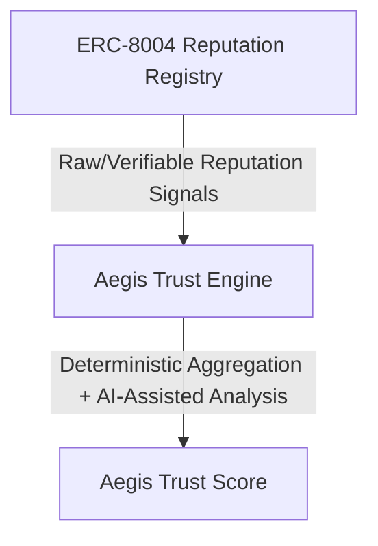

# AegisAgent Reputation Registry Architecture

## 1. Purpose
The Reputation Registry provides an immutable, on-chain feedback system for autonomous AI agents. It aims to strictly implement the ERC-8004 draft specification to serve as a decentralized ledger for clients to rate and review agent performance based on their interactions. This provides raw, verifiable trust signals without mandating any specific score aggregation logic on-chain.

## 2. Architecture
The Reputation Registry acts as a dependent layer on top of the deployed `AegisIdentityRegistry` (which acts as the Identity Registry component of ERC-8004). 

**Flow:**
1. Client interacts with the Agent.
2. Client submits `giveFeedback()` to the Reputation Registry.
3. Reputation Registry calls the Identity Registry to verify the agent's existence and check ownership constraints (anti-self-feedback).
4. Off-chain Trust Engine reads the signals and events to compute the Aegis Trust Score.

The registry does not compute an aggregated score or modify the Identity Registry state. It acts strictly as an append-only (and conditionally revocable) log of feedback.

## 3. ERC-8004 Compatibility
The Aegis Reputation Registry is designed for strict compatibility with the current ERC-8004 draft.
- **A. ERC-8004 exact interface**: Fully implemented as specified, including feedback submission, revocation, permissionless responses, and complex read interfaces.
- **B. ERC-8004 security requirements**: Adheres to per-client feedback indexing, prevents self-feedback, and maintains an auditable trail for revoked feedback.
- **C. AegisAgent conventions/extensions**: Leverages `tag1` and `tag2` as structured qualitative and contextual data fields off-chain.
- **D. Optional features we may defer**: None currently identified.
- **E. Intentional implementation differences**: We enforce a strict anti-self-feedback check for `giveFeedback` against the Identity Registry, preventing the owner/operator from reviewing themselves.

## 4. Contract Interface

### Core Functions
```solidity
function initialize(address identityRegistry) external;

function getIdentityRegistry() external view returns (address);

function giveFeedback(
    uint256 agentId,
    int128 value,
    uint8 valueDecimals,
    string calldata tag1,
    string calldata tag2,
    string calldata endpoint,
    string calldata feedbackURI,
    bytes32 feedbackHash
) external;

function revokeFeedback(
    uint256 agentId,
    uint64 feedbackIndex
) external;

function appendResponse(
    uint256 agentId,
    address clientAddress,
    uint64 feedbackIndex,
    string calldata responseURI,
    bytes32 responseHash
) external;
```
**Notes on `giveFeedback`:**
- `value` is `int128` (allows negative or positive metrics).
- `valueDecimals` must be 0–18.
- `tag1` and `tag2` are optional strings.
- `endpoint`, `feedbackURI`, and `feedbackHash` are optional and **not** stored in contract storage. They are emitted in the `NewFeedback` event. `feedbackHash` can be `bytes32(0)` (e.g., when using content-addressed IPFS URIs).

### View Functions
```solidity
function getSummary(
    uint256 agentId,
    address[] calldata clientAddresses,
    string calldata tag1,
    string calldata tag2
) external view returns (
    uint64 count,
    int128 summaryValue,
    uint8 summaryValueDecimals
);
```
*Note: `clientAddresses` are mandatory and MUST be non-empty. Filtering by reviewers is critical for Sybil/spam resistance so clients can aggregate scores only from trusted peers.*

```solidity
function readFeedback(
    uint256 agentId,
    address clientAddress,
    uint64 feedbackIndex
) external view returns (
    int128 value,
    uint8 valueDecimals,
    string tag1,
    string tag2,
    bool isRevoked
);

function readAllFeedback(
    uint256 agentId,
    address[] calldata clientAddresses,
    string calldata tag1,
    string calldata tag2,
    bool includeRevoked
) external view returns (
    address[] memory clients,
    uint64[] memory feedbackIndexes,
    int128[] memory values,
    uint8[] memory valueDecimals,
    string[] memory tag1s,
    string[] memory tag2s,
    bool[] memory revokedStatuses
);

function getResponseCount(
    uint256 agentId,
    address clientAddress,
    uint64 feedbackIndex,
    address[] calldata responders
) external view returns (uint64 count);

function getClients(
    uint256 agentId
) external view returns (address[] memory);

function getLastIndex(
    uint256 agentId,
    address clientAddress
) external view returns (uint64);
```

### Events
```solidity
event NewFeedback(
    uint256 indexed agentId,
    address indexed clientAddress,
    uint64 feedbackIndex,
    int128 value,
    uint8 valueDecimals,
    string indexed indexedTag1,
    string tag1,
    string tag2,
    string endpoint,
    string feedbackURI,
    bytes32 feedbackHash
);

event FeedbackRevoked(
    uint256 indexed agentId,
    address indexed clientAddress,
    uint64 indexed feedbackIndex
);

event ResponseAppended(
    uint256 indexed agentId,
    address indexed clientAddress,
    uint64 indexed feedbackIndex,
    address indexed responder,
    string responseURI,
    bytes32 responseHash
);
```

## 5. Storage Model
```solidity
struct Feedback {
    int128 value;
    uint8 valueDecimals; // Enforced 0-18
    bool isRevoked;
    string tag1;
    string tag2;
}

// Storage Maps
// agentId -> clientAddress -> feedbackIndex -> Feedback
mapping(uint256 => mapping(address => mapping(uint64 => Feedback))) private _agentClientFeedback;

// agentId -> clientAddress -> lastIndex
mapping(uint256 => mapping(address => uint64)) private _agentClientFeedbackCount;

// agentId -> unique clients
mapping(uint256 => address[]) private _agentClients;

// Reference to deployed AegisIdentityRegistry
address private _identityRegistry; 
```
**Rationale & ERC-8004 Compliance**:
- The feedback index is a 1-indexed counter of submissions made by a specific `clientAddress` to a specific `agentId`. This avoids a globally unified index, maintaining the strict composite key `(agentId, clientAddress, feedbackIndex)`.
- `endpoint`, `feedbackURI`, and `feedbackHash` are deliberately excluded from the `Feedback` struct to save gas. The draft standard specifies they are emitted in the `NewFeedback` event.
- The `_agentClients` mapping is maintained by pushing to the array only when `_agentClientFeedbackCount[agentId][msg.sender]` is 0 during `giveFeedback`.

## 6. Feedback Lifecycle
1. Client interacts with an agent.
2. Client calls `giveFeedback`.
3. Registry validates `agentId` exists via the `AegisIdentityRegistry`.
4. Registry verifies caller is NOT the agent owner or an approved operator (Anti-self-feedback).
5. Registry stores the core composable reputation fields and increments the `clientAddress`'s feedback index for that agent.
6. Emits `NewFeedback` with all rich context (URIs, endpoints, hashes).

## 7. Revocation Lifecycle
1. The original `clientAddress` of a specific feedback calls `revokeFeedback(agentId, feedbackIndex)`.
2. Sets `isRevoked = true` (does not delete data, ensuring auditable trail).
3. Emits `FeedbackRevoked`.

## 8. Response Lifecycle
1. Anyone (permissionless) calls `appendResponse`. `appendResponse` is NOT restricted to the agent owner/operator in the current ERC-8004 draft.
2. The contract uses `msg.sender` as the `responder`.
3. Emits `ResponseAppended` ensuring the responder's identity is transparent. Response data is not stored in contract arrays, relying exclusively on event emission.

## 9. Security Model
- **Valid Agent Requirement**: Operations require the `agentId` to exist in the Identity Registry.
- **Anti-Self-Feedback**: `giveFeedback` strictly reverts if `msg.sender` is the agent owner or an approved operator for that `agentId`.
- **Value Bounds**: `valueDecimals` is strictly bounded between 0-18.
- **Per-Client Indexing**: Indexes are strictly scoped to the `clientAddress`, preventing collision and ensuring deterministic ordering per reviewer.
- **Client-Only Revocation**: Only the exact `clientAddress` that submitted a feedback entry can revoke it. Revoked feedback is flagged, not deleted, remaining auditable.
- **Permissionless Responses**: Anyone can respond to feedback. The responder's identity (`msg.sender`) is permanently recorded in the `ResponseAppended` event.
- **Client Filtering**: `getSummary` enforces `clientAddresses` arrays to mitigate Sybil/spam data.
- **No Identity Registry Mutation**: The Reputation Registry is entirely read-only against the Identity Registry.
- **No Arbitrary Trust Score Writes**: The contract only stores objective, immutable feedback components, delegating score generation off-chain.

## 10. AegisAgent Extensions
We use structured conventions for `tag1` and `tag2` off-chain to aid downstream aggregation:
- `tag1` (Qualitative): `quality`, `successRate`, `reliability`, `responseTime`, `taskCompletion`, `validation`.
- `tag2` (Contextual): `task:XYZ`, `model:claude`, `domain:defi`, `timeframe:Q4`.
These remain strictly optional conventions at the contract level.

## 11. Trust Engine Separation

The contract **does not** calculate trust scores or integrate Gemini/API logic into Solidity. The Aegis Trust Engine reads signals off-chain to produce the final score.

## 12. Gas Considerations
- **Monad EVM Compatibility**: Deployments on Monad benefit from higher gas throughput, but optimizing state is still crucial.
- **String Storage**: Storing strings like `endpoint`, `feedbackURI`, and `feedbackHash` on-chain is expensive. Adhering to ERC-8004 by keeping these event-only is highly gas-efficient.
- **Dynamic Arrays**: Avoided storing responses inside the `Feedback` struct to keep the state footprint lightweight.
- **Index Segregation**: `(agentId, clientAddress, feedbackIndex)` lookup avoids massive global arrays, enabling cheaper targeted reads.
